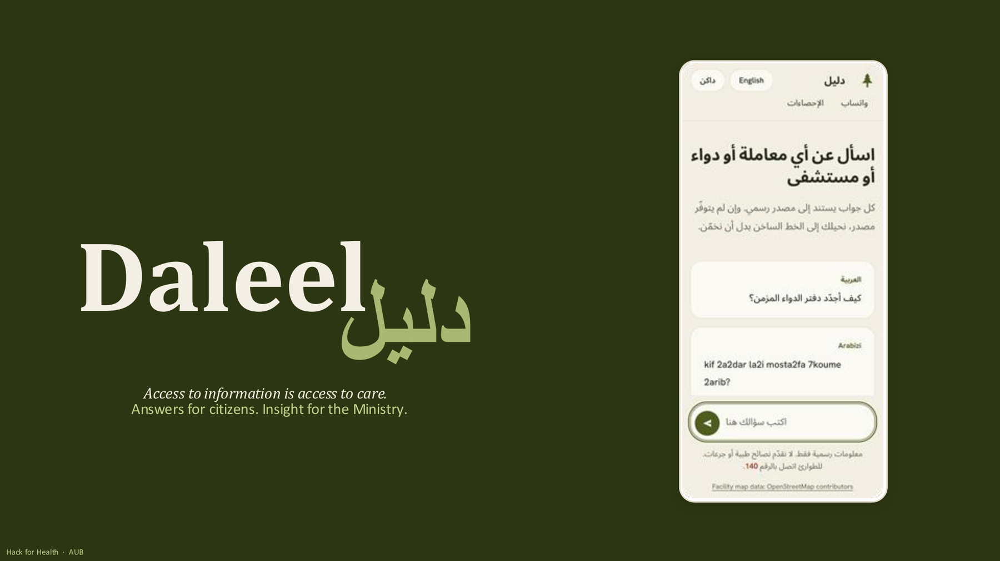
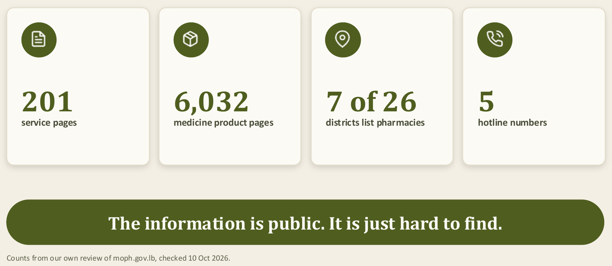
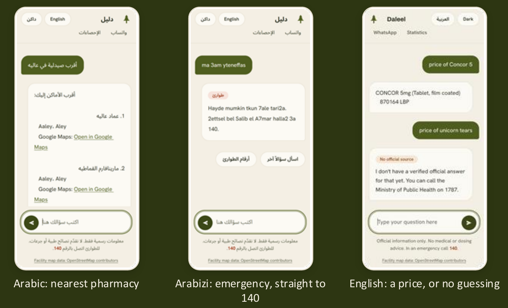
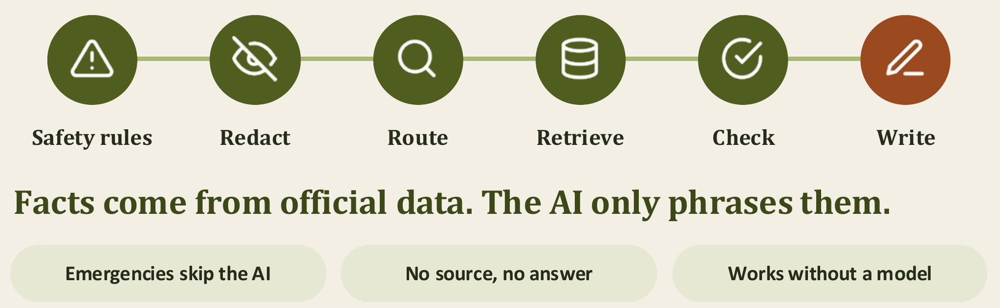
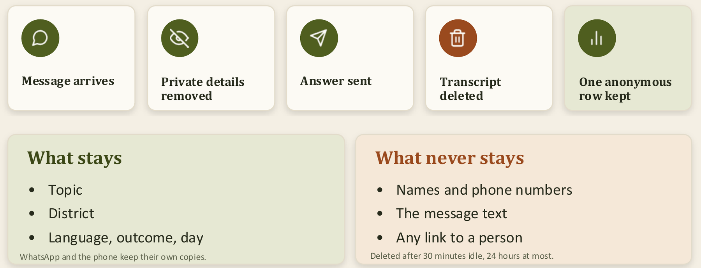
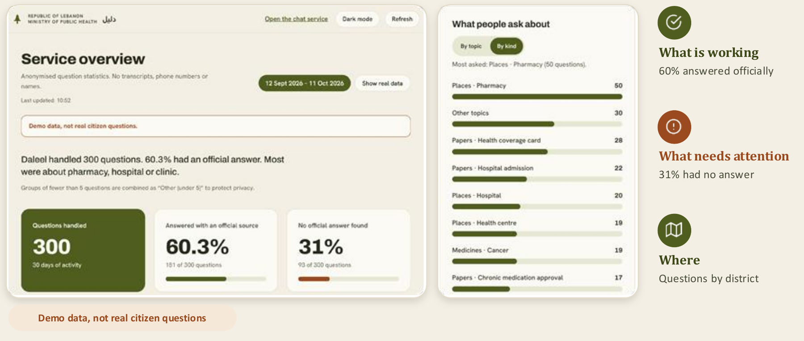

<div align="center">



<br>


### Ask about any procedure, medicine or hospital in Lebanon.
**Get an answer from an official source, or the right hotline. Never a guess.**

*Answers for citizens. Insight for the Ministry.*

</div>

<br>

## 🌲 The problem

Citizens call 1787, 1214, 1564 or 140. Then they go to the ministry, find a paper missing, and come back another day. One verification, many visits.



<table width="100%">
<tr>
<td width="50%"><b>Citizens lose time</b><br>Hours · Trips · Doubt</td>
<td width="50%"><b>The Ministry loses sight</b><br>Repetitive calls · Visits · Blind spots</td>
</tr>
</table>

## 🌲 One place to ask

<table width="100%">
<tr>
<td align="center" width="25%"><b>Procedures</b><br><sub>Which papers?</sub></td>
<td align="center" width="25%"><b>Places</b><br><sub>Where to go?</sub></td>
<td align="center" width="25%"><b>Medicines</b><br><sub>What does it cost?</sub></td>
<td align="center" width="25%"><b>Hotlines</b><br><sub>Who to call?</sub></td>
</tr>
</table>

People are already on WhatsApp. Text Daleel or send a voice note. No app, no sign-up. It is also on the web.



### Built for how Lebanon actually writes

<table width="100%">
<tr>
<th align="center">English</th>
<th align="center">العربية</th>
<th align="center">Arabizi</th>
<th align="center">Français</th>
</tr>
<tr>
<td align="center">my father is not breathing</td>
<td align="center">أبي مش عم يتنفس</td>
<td align="center">ma 3am yteneffas</td>
<td align="center">mon père ne respire plus</td>
</tr>
<tr>
<td align="center" colspan="4"><b>→ 140, the Red Cross. The same answer, in your language.</b></td>
</tr>
</table>

## 🌲 The AI writes. It never decides what is true.



If Daleel cannot verify an answer, it hands over to the hotline instead of guessing.

## 🌲 We keep the pattern, never the person



## 🌲 For the Ministry: information as data



Next up is hotspot alerts built on data Daleel already stores: when one topic spikes in one district (5 or more people, double last week), the Ministry sees it before it becomes a crisis.

## 🌲 What works today, and what is next

<table width="100%">
<tr>
<th align="left" width="50%">Works today</th>
<th align="left" width="50%">Next</th>
</tr>
<tr>
<td valign="top">
Places, prices, hotlines<br>
Safety rules in 4 languages<br>
Redaction and auto-delete<br>
Voice notes<br>
Ministry dashboard<br>
Live WhatsApp number
</td>
<td valign="top">
Self-hosted model<br>
French and Arabizi places<br>
Confirm free medicines<br>
Keep pages current
</td>
</tr>
</table>

Built for one Ministry, ready for many: other ministries, Daleel as a hosted service with one workspace each, and other countries. Same engine, their sources, their dashboard.

## 🌲 Run it

```bash
python -m venv .venv && source .venv/bin/activate
pip install -r requirements.txt
cp .env.example .env            # add ANTHROPIC_API_KEY
docker compose up -d            # Postgres + pgvector (+ pg_trgm)
PYTHONPATH=src uvicorn core.app:app --reload
PYTHONPATH=src pytest -q        # all green
```

Then open `web/index.html`. Full setup in [docs/GETTING_STARTED.md](docs/GETTING_STARTED.md), system design in [docs/ARCHITECTURE.md](docs/ARCHITECTURE.md), and the team workflow in [docs/TEAM.md](docs/TEAM.md).

**Stack:** FastAPI · Postgres + pgvector · Twilio WhatsApp · a pluggable language model (self-hosted, hosted, or none)

<br>

<div align="center">

**Access to information is access to care.** · **دليل**

<sub>Built at Hack for Health · American University of Beirut · 2026<br>Forked from the team repository, <a href="https://github.com/mariamelwirish/hack4health">mariamelwirish/hack4health</a></sub>

</div>
