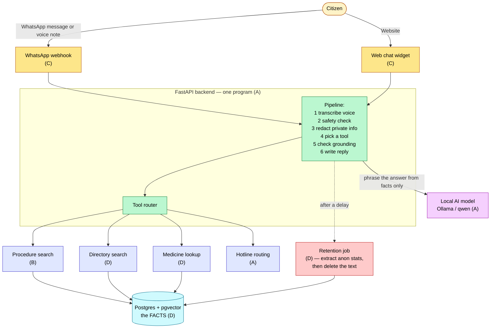
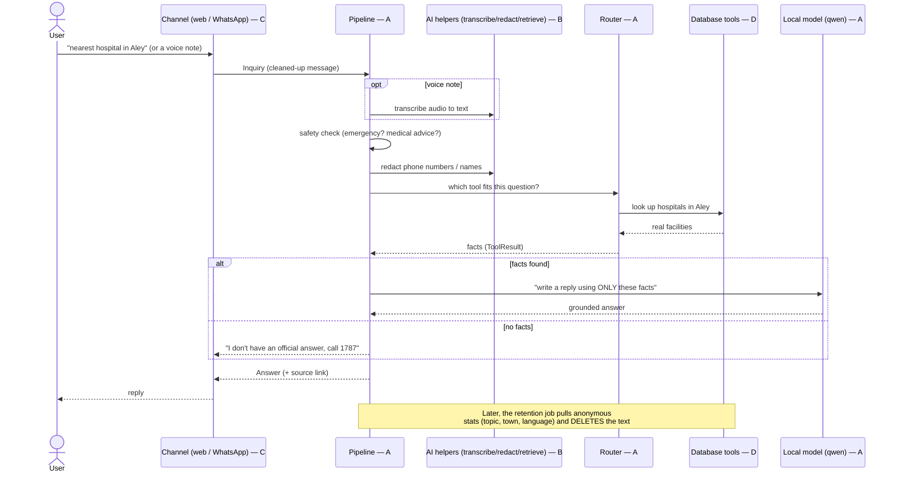
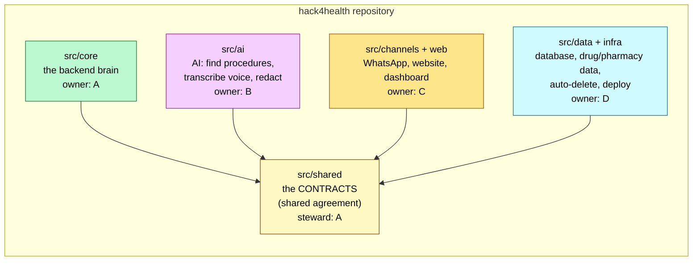
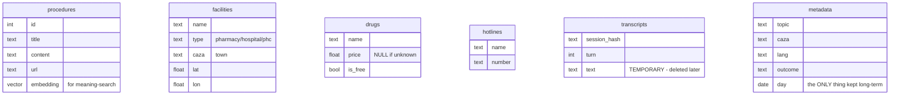

# Daleel — Team Handbook (read this to understand the whole project)

Written for humans, assuming **no prior knowledge**. If you've been using an AI agent to write code but don't really know what the project *is* or how the pieces fit — this document is for you. Read it top to bottom once.

> **TL;DR:** We're building a health-info chatbot for Lebanon's Ministry of Public Health. It works on WhatsApp and a website, in Arabic/Arabizi/French/English. It answers four kinds of questions using *verified data* (never making things up). The code is split into 4 folders, one per developer, so you never step on each other. About **60–65%** is done: the skeleton and 3 of the 4 question types work; the biggest missing piece is loading the "procedures" data (B's job) and the privacy auto-delete (D's job).

## Contents
1. What we're building & why
2. Glossary (every technical word, in plain English)
3. The big picture (architecture diagram)
4. What happens when someone sends a message (flow diagram)
5. The code: 5 folders, one owner each
6. The data: what's in the database (diagram)
7. The clever trick that lets us work independently
8. Build log — everything finished so far
9. What works right now & how to test it
10. What's left until submission
11. How to run the whole thing

---

## 1. What we're building & why

**The problem:** People in Lebanon can't easily find basic health-system info — which papers a procedure needs, where the nearest open pharmacy is, whether a medicine is free, which hotline to call. So they flood the ministry's phone line or give up.

**Our solution — "Daleel" (دليل = "guide"):** a chatbot on **WhatsApp** and a **website** that answers those questions in the user's language, with a link to the official source, and hands off to a human hotline when it doesn't know.

**Two phases:**
- **Phase 1 (the hackathon):** the chatbot. ← what we're building now
- **Phase 2 (later):** a dashboard for the ministry showing what people ask most, built from *anonymous* data. We're already preparing for it (every conversation leaves behind anonymous stats, then the actual text is deleted).

**The golden rule of the whole system:** the bot answers **only from verified data we loaded**, never from the AI's imagination. For a health ministry, "I don't know, call 1787" is far safer than a confident wrong answer.

---

## 2. Glossary (plain English)

| Term | What it actually means here |
|------|------------------------------|
| **Backend** | The program running on a server that receives a question and figures out the answer. Ours is one program both WhatsApp and the website talk to. |
| **API / endpoint** | A "door" into the backend. E.g. `/chat` is the door you send a question to; `/health` is a door that just says "I'm alive." |
| **FastAPI** | The Python tool we use to build those doors. |
| **LLM (large language model)** | The "AI brain" that reads a question and writes a human-sounding reply. Ours is **qwen**, run **locally and free** (no paid API). |
| **Ollama** | The app that runs the LLM on your own laptop. You `ollama pull qwen2.5:7b` once to download the brain (our committed model). |
| **RAG (retrieval-augmented generation)** | The pattern we use: first *retrieve* real facts from our database, then let the LLM *phrase* them. The LLM is a writer, not a source of facts. |
| **Database / Postgres** | Where the real facts live (drugs, pharmacies, procedures). We use Postgres with an add-on called **pgvector**. |
| **pgvector** | A Postgres add-on that lets us search text *by meaning* (so an Arabizi question can match Arabic text). Used for procedures. |
| **Webhook** | A door WhatsApp calls automatically whenever someone messages the bot. |
| **Contract** | A shared definition of the data shapes every part agrees on (what an "Inquiry" or an "Answer" looks like). Lives in `src/shared/contracts.py`. |
| **Stub** | A fake placeholder version of a part that isn't built yet, so the app still runs. Real code replaces it automatically. |
| **Grounding** | The check that the bot's answer is actually backed by retrieved facts; if not, it refuses and gives a hotline. |
| **Redaction** | Stripping out phone numbers / names / IDs *before* sending text to the AI, for privacy. |
| **Retention job** | A scheduled task that pulls anonymous stats from a conversation, then **deletes** the actual text. |
| **Docker / container** | A way to run the database in a self-contained box with one command (`docker compose up -d`). |
| **Branch / commit / push / merge** | Git terms: a *commit* is a saved change; *push* uploads it to GitHub; a *branch* is a safe copy to work on; *merge* folds work into the shared `main` version. |

---

## 3. The big picture (architecture)

One backend. Two ways in (WhatsApp, web). Four "tools" it can use to answer. One database of facts. One local AI model to phrase answers.



The letters (A/B/C/D) show who owns each part.

---

## 4. What happens when someone sends a message

Follow one question through the system. The safety rules and the grounding check "bracket" the AI: nothing reaches it before private info is stripped, and nothing leaves it unless real facts back it up.



---

## 5. The code: 5 folders, one owner each

The project is **one repository** split into folders. **You only edit your own folder** — that's how 4 people work at once without conflicts.



| Folder | Owner | In plain words |
|--------|-------|----------------|
| `src/shared` | A (shared) | The common "language" — the shape of a question, an answer, etc. Everyone depends on it. |
| `src/core` | **A** | The brain: receives the question, runs safety → redact → pick tool → check → reply. |
| `src/ai` | **B** | The smart bits: find the right procedure document, transcribe voice notes, strip private info. |
| `src/channels` + `web` | **C** | The ways people reach the bot: WhatsApp, the website chat, the dashboard page. |
| `src/data` + `infra` | **D** | The facts & the plumbing: the database, the drug/pharmacy lists, the auto-delete job, hosting. |

The healthcare teammate (5th, non-coder) picks and verifies the real procedures, writes the test questions, and leads the pitch.

---

## 6. The data: what's in the database

All the facts live in one Postgres database. These are the tables:



**Loaded right now:** 403 drugs, 1,160 facilities (pharmacies/hospitals), 4 hotlines, 26 towns — **but 0 procedures** (that's the gap). `transcripts` is temporary; `metadata` is the anonymous stuff that survives for Phase 2.

---

## 7. The clever trick that lets us work independently

This is the single most important idea to understand.

The brain (`core`) never calls B's or D's code directly. Instead, there's a file `src/core/providers.py` that says, in effect:

> "Try to use B's real procedure-search. If it doesn't exist yet, use a **fake placeholder (stub)** so the app still runs."

So:
- The app **always runs**, even if B, C, or D haven't written their part yet (it uses placeholders).
- The moment someone pushes their real code with the agreed name, the app **automatically starts using it** — nobody edits anyone else's files.
- Everyone agreed on the **contracts** (`src/shared/contracts.py`) on day one, so the pieces always fit.

That's why, as you've seen, loading D's drug data made medicine questions start working with zero changes to the brain.

---

## 8. Build log — everything finished so far

Chronological, in plain language. (103 automated tests currently pass.)

**Foundations (A):**
- Set up the repo so agents can work: the shared contracts, a runnable backend, placeholder stubs, automated tests, and all the planning docs.

**A — backend brain (COMPLETE):**
- `/chat` and `/health` doors; serves the website at `/`.
- Connected a **free local AI model** (qwen via Ollama) — no paid key.
- **Safety rules:** emergencies → "call 140"; dosing questions → refuse → pharmacist. Works in Arabic, Arabizi, French, English.
- **Grounding:** if no real facts back an answer, it says "call 1787" instead of guessing.
- **Tool router:** decides which of the 4 tools a question needs (keyword rules first — reliable with the small model — then the AI for unclear ones).
- **Voice + redaction wired** into the pipeline (the real versions are B's; the wiring is done).
- **Integration:** extracts the town from a question and passes it to D's pharmacy/hospital search, and degrades gracefully if the model or DB is down.

**D — data & infrastructure (~70%):**
- Designed the database (9 tables) and a one-command setup.
- Loaded real data: 403 drugs, 1,160 facilities, 4 hotlines, 26 towns.
- Built **medicine lookup** and **directory search** (with town-name matching: "Aley" / "عاليه" / "3ale").

**C — channels & website (mostly done):**
- The **website chat widget** (right-to-left Arabic, 4 languages, source links, quick-reply buttons).
- The **WhatsApp webhook** (with security check and voice-note intake).
- The **dashboard** stub for Phase 2, plus a QR-code join page for WhatsApp.

**B — AI & retrieval (just started):**
- Connected to the database and can count procedures. That's the groundwork; the actual procedure-loading and search are next.

---

## 9. What works right now & how to test it

Start the app (see §11), open **http://localhost:8000**, and type these:

| Type this | What you get | Status |
|-----------|--------------|--------|
| `nearest hospital in Aley` | real hospitals from the database | ✅ |
| `nearest pharmacy in Beirut` | real pharmacies | ✅ |
| `how much does panadol cost?` | finds the drug; says "call 1787" if no price | ✅ |
| `my father is not breathing` | emergency → call **140** | ✅ |
| `what dose of panadol for my baby?` | refuses → see a pharmacist | ✅ |
| `price of unicorn tears` | "no official answer, call 1787" (won't invent) | ✅ |
| `how do I renew the chronic-medication booklet?` | "no official source, call 1787" | ⏳ needs B to load procedures |
| a WhatsApp voice note | placeholder text for now | ⏳ needs B's real transcription |

Run all automated checks: `PYTHONPATH=src pytest -q` → **103 passed**.

---

## 10. What's left until submission

```mermaid
flowchart LR
    subgraph done["✅ DONE"]
        d1["Backend brain (A)"]
        d2["Database + drugs/pharmacies (D)"]
        d3["Website + WhatsApp code (C)"]
        d4["Safety, grounding, routing (A)"]
    end
    subgraph crit["🔴 CRITICAL PATH"]
        c1["B1/B2: load procedures<br/>+ meaning-search"]
        c2["D5: auto-delete job<br/>(privacy = scored)"]
        c3["B3: real redaction"]
    end
    subgraph next["🟡 THEN"]
        n1["A: wire C's WhatsApp<br/>routes (1 line)"]
        n2["Twilio creds → WhatsApp live"]
        n3["B4: real voice transcription"]
        n4["D6: deploy to public URL"]
        n5["B6: test set + bigger model"]
    end
    done --> crit --> next

    classDef gdone fill:#bbf7d0,stroke:#15803d,color:#000
    classDef gcrit fill:#fecaca,stroke:#b91c1c,color:#000
    classDef gnext fill:#fde68a,stroke:#b45309,color:#000
    class d1,d2,d3,d4 gdone
    class c1,c2,c3 gcrit
    class n1,n2,n3,n4,n5 gnext
```



**Priority order (and who):**
1. **B** — load the real procedure documents + meaning-search (**B1/B2**). *This is the headline feature; without it the signature "how do I get X" demo fails.*
2. **D** — the auto-delete / retention job (**D5**) **+ B** — real redaction (**B3**). *Privacy is explicitly scored by the judges.*
3. **A** — wire C's WhatsApp/dashboard routes into the main app (one line), then **someone adds Twilio credentials** so WhatsApp works live.
4. **B** — real voice-note transcription (**B4**). *Voice was called a core feature.*
5. **D** — deploy to a public web address (**D6**) so WhatsApp can reach it.
6. **B** — a test-question set for a "pass rate" slide, and ideally a bigger AI model for better Arabic (**B6**).

**Status: ~60–65% to a confident demo.** The foundation is solid and 3 of 4 question types work with real data. The remaining weight is mostly on **B** (procedures, voice, redaction) and **D's auto-delete job**.

**Timeline reminder:** feature freeze **Sun 10:00**, submission **Sun 14:00**. If something slips, cut scope (fewer procedures) — never cut the privacy pieces.

---

## 11. How to run the whole thing

```bash
# one-time
python -m venv .venv && source .venv/bin/activate
pip install -r requirements.txt
#   install Ollama (the local AI runner), then download a model:
ollama pull qwen2.5:7b          # ~4.7 GB; the team's ONE committed model (download once)

# every work session
docker compose up -d                      # start the database
PYTHONPATH=src python -m data.loaders     # load the drug/pharmacy data (once)
PYTHONPATH=src uvicorn core.app:app --reload   # start the backend + website at :8000
PYTHONPATH=src pytest -q                   # run the automated checks (expect 103 passed)
```
Open **http://localhost:8000**. To stop the backend: `Ctrl+C` (or `pkill -f "uvicorn core.app"`).
If you see `UndefinedTable`, the database isn't running → `docker compose up -d`.

**More detail:** `docs/GETTING_STARTED.md` (per-person setup), `docs/ARCHITECTURE.md` (design), `docs/CONTRACTS.md` (the shared data shapes), `docs/PLAN.md` (sprints), `docs/STATUS.md` (current status), `docs/tickets/` (each person's task list).
